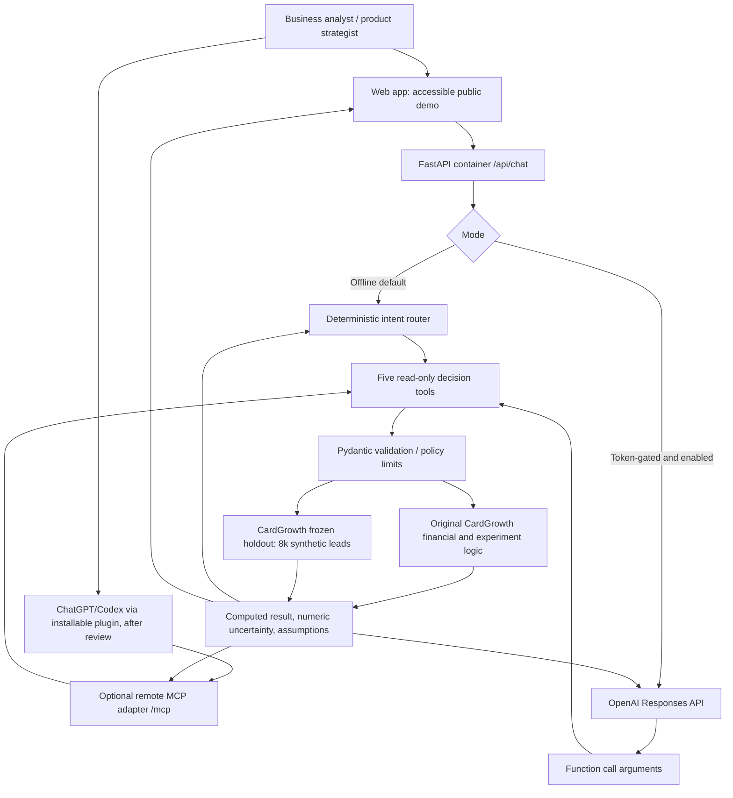

# Architecture and analytical boundaries

**Privacy:** no file upload, raw SQL execution, writes, automatic marketing actions or banking data. 

**Trust boundary:** an LLM can select only named functions with bounded numeric inputs. It cannot run arbitrary Python, control database queries, access customer accounts, or use bank systems. Tool output is evidence, not instructions. The frontend renders user-provided text as text and escapes the tool-grounded markdown response.

**Source of truth:** original CardGrowth Project 3 snapshot scores, not an invented new cohort. Model values are synthetic predictions; financial decisions would require causal pilot evidence and separately validated credit-risk economics.

**Technical debt for production:** live cloud/SDK integration tests, stronger token/auth provider, edge quotas, audit logs, robust structured output and trace validation, serverless MCP session strategy, privacy notices, publisher verification, and independent model governance.
